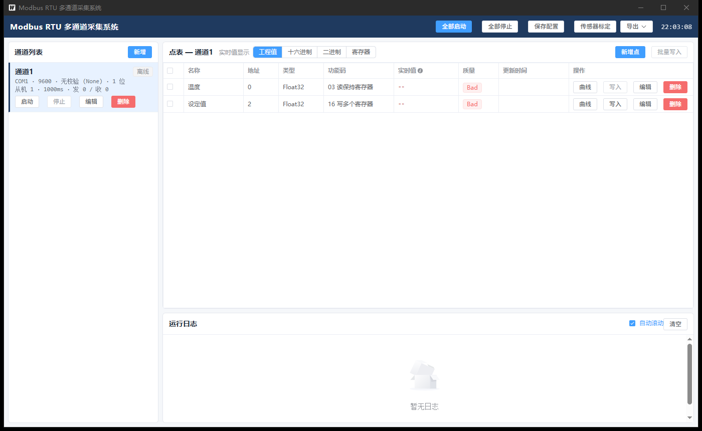
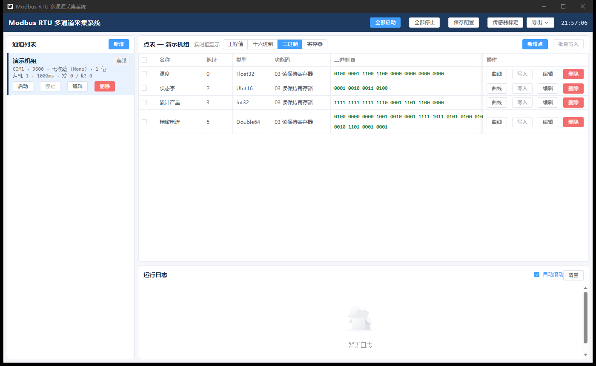
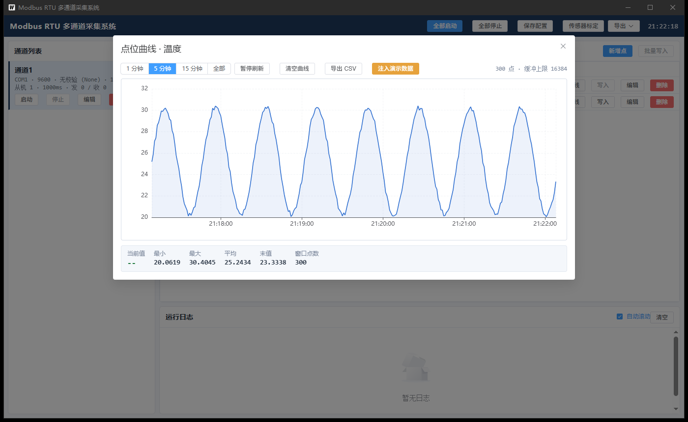
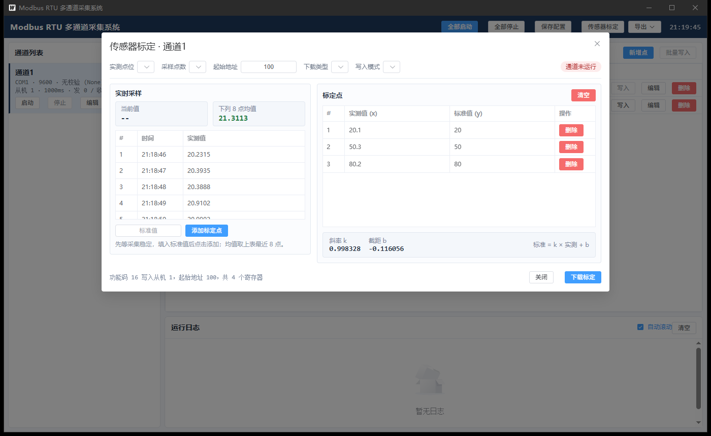
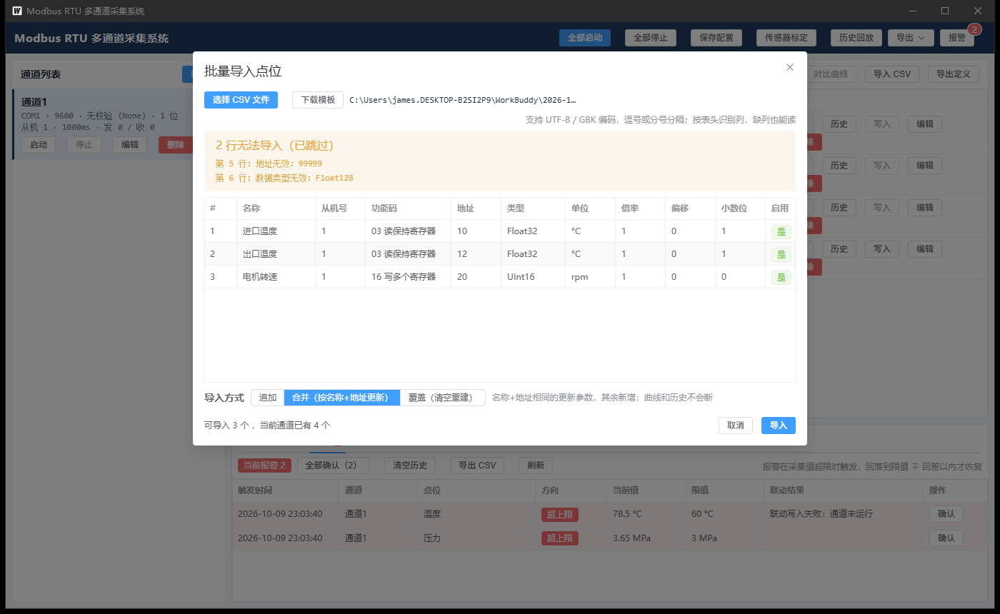
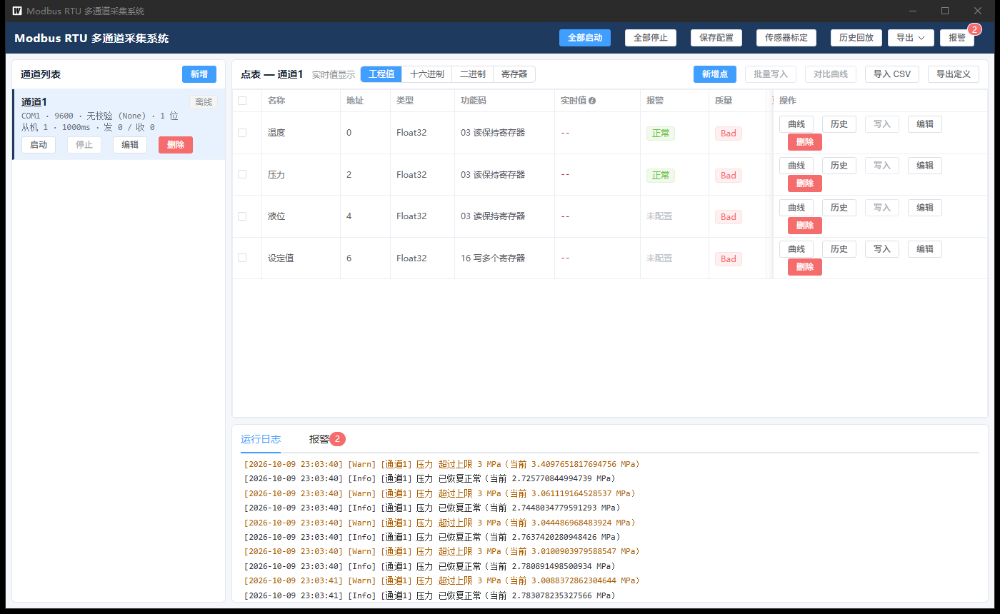
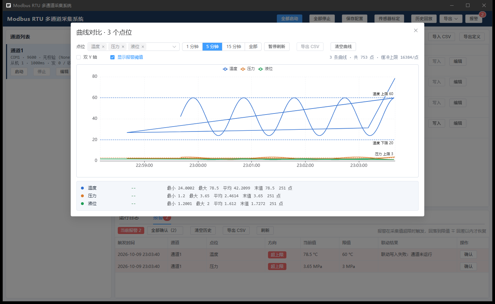
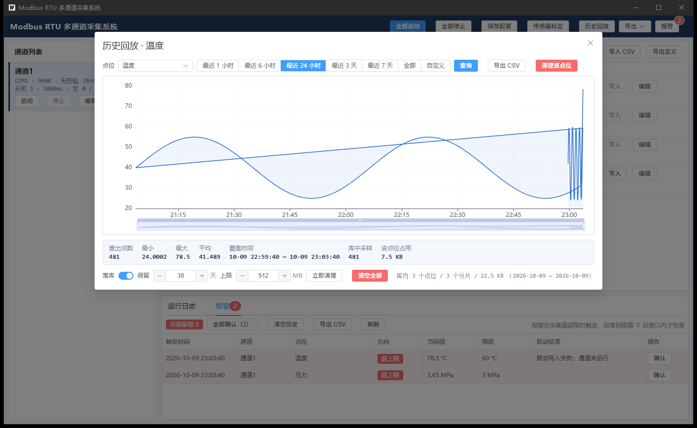

# Modbus RTU 多通道采集系统（Go / Wails v2 版）

原 C# WPF 版（`jameslan520/modbus-hub`）的 Go 重构。技术栈：**Wails v2.16 + Go 1.27 + Vue 3 + Element Plus + ECharts**，
产出单文件 exe（约 15 MB，依赖系统 WebView2 运行时），目标机无需安装 .NET。



## 功能

### 第一阶段：采集与写入

- 多通道管理：新增 / 编辑 / 删除 / 启动 / 停止 / 全部启动 / 全部停止，配置存 `channels.json`（与 exe 同目录）。
- 每条通道可选两种连接方式（详见「第八阶段」）：**串口 RTU**（COM 口）与 **Modbus TCP**（IP + 端口）。
- 串口参数：串口号、波特率、**数据位(7/8)**、**校验位(无/奇/偶)**、**停止位(1/2)**、读写超时、轮询周期、从机号。
- 网口参数：**目标 IP（或主机名）、端口（默认 502）、单元标识**（即串口侧的从机号）、读写超时、轮询周期。
- 数据点：功能码 03/06/16，类型 UInt16 / Float32 / Double64 / Int32，倍率、偏移、单位、小数位、启用采集。
- 协议层自建：CRC16、03 读保持寄存器、06 写单个寄存器、16 写多个寄存器，超时 3 次重试（间隔 250 ms），从机异常码翻译为中文。RTU 与 TCP 共用同一套 PDU 逻辑。
- 字序：Float32 / Int32 为 **CDAB**，Double64 为 **GHEF CDAB**（与 C# 版完全一致，有单元测试锁定）。
- 分块读取：按从机号 + 地址自动合并，单次最多 125 个寄存器。
- 单点写入（写后回读校验）、批量连续写入（16 功能码，地址连续性校验 + PDU 120 寄存器拆包）。
- 运行日志：通道连接、读写失败去重上报（块级失败与单点失败分别处理）、最多保留 500 条。

### 第二阶段：曲线、标定与导出

- **实时趋势曲线**：每个点位独立环形缓冲（16384 点），时间窗口 1 / 5 / 15 分钟 / 全部可切换，暂停刷新、清空曲线、导出 CSV。
- **传感器标定**：选实测点位 → 取最近 N 点（5/8/10/15/20）均值 → 填标准值累加标定点 → 最小二乘拟合显示斜率 k 与截距 b。
- **标定下载**：两种写入模式（标定表「实测、标准交替」/ 斜率截距「k、b」），功能码 16 写入指定起始地址，超限自动分块。
- **导出 CSV**：当前通道点表（含实时值、十六进制、原始寄存器与质量）、运行日志、曲线数据，均带 UTF-8 BOM（Excel 直接打开不乱码）。

### 第二阶段补充：实时值的四种显示口径

点表标题栏可切换 `工程值 / 十六进制 / 二进制 / 寄存器`，切换即时生效、不重新采集，列宽随口径自动调整：

| 口径 | 内容 | 举例（Float32 25.5） |
|---|---|---|
| 工程值 | 按倍率、偏移、小数位、单位换算后的人类可读值 | `25.50 °C` |
| 十六进制 | 值的机器位模式，UInt16 16 位 / Float32、Int32 32 位 / Double64 64 位 | `0x41CC0000` |
| 二进制 | 同上，按 4 位一组分组；Double64 的 64 位会折成两行 | `0100 0001 1100 1100 0000 0000 0000 0000` |
| 寄存器 | 报文中该点占用的**原始寄存器**，按线序排列（未做字序重排） | `0x0000 0x41CC` |

几个要点：

- 浮点数按 **IEEE754 位模式**展示（Float32 取 32 位、Double64 取 64 位），Int32 按**补码**展示，便于核对下位机的位定义。
- **寄存器口径**用于排查字序问题：CDAB 点位在这里会看到低字在前（`0x0000 0x41CC`），一眼就能确认设备发的是不是 CDAB。
- 位模式在后端计算而非前端反推：float32 经 JSON 变成 float64 后尾数会变形，前端反推会得到错误的位模式。
- 单元格**点击即复制**，鼠标悬停显示该口径的说明与完整文本（长值列被压缩时靠它兜底）。
- 采集失败的点仍显示 `ERR`，不显示旧位模式，避免误读。







### 第四阶段：地址三形式输入与多通道同屏

#### 1. 寄存器地址支持三种输入写法

点参数对话框的「寄存器地址」字段不再只认十进制，**形式下拉 + 文本框**两段式输入：切换形式时自动按目标写法换算当前值（不用现场翻 PLC 地址表）。每写一个字符（150 ms 防抖）调一次后端 `ParseAddressInput` 实时校验，下方提示行同步显示三种等价写法。

| 形式 | 写法示例 | 适用场景 |
|---|---|---|
| 十进制 | `0`、`100`、`65535` | 协议地址直填；填 ≥40001 会提示"可能来自 PLC 图纸" |
| 十六进制 | `0x0064`、`0064`、`64h` | 设备手册用十六进制时；带 `0x` / `h` 标记的输入**强制按十六进制解释**，即便当前形式是十进制或 PLC |
| PLC 地址 | `40001`（5 位）、`400001`（6 位，用于 >9998 的地址） | 对着 PLC 图纸找点最常见；首位的 4 表明是保持寄存器 |

非保持寄存器区（如 `30001` 是输入寄存器）解析得出来也用不了，直接按 ⚠ 提示：后端功能码 03/06/16 只走 4xxxx。非 5/6 位的 PLC 写法（如 `4001`）按 ✗ 提示规则。规则统一在后端，单测覆盖 9 个用例（`internal/modbus/address_test.go`）。

#### 2. 通道列表支持多选监视

左侧通道列表每行多了一个**复选框**：点通道行 = 「只监视它」（原来的单选习惯），勾复选框 = 「把通道并入监视集合」。

- 标题变为「点表 — 监视 N 点 / 多通道」，主通道的「新增 / 导入 / 导出」作用对象会显示在标题旁。
- 点表多出**「通道」列**；地址列默认显示十进制协议地址，鼠标悬停弹出**三种写法**。
- 至少保留一个通道在监视集合里，全部移出时自动把当前主通道加回来。
- 批量写入只能同一通道内（功能码 16 是一帧写多个寄存器，天然不能跨串口）——勾选跨通道时直接拦下。

### 第五阶段：多寄存器数值的字节顺序可配

点参数对话框在数据类型为 **Float32 / Int32 / Double64** 时多出「字节顺序」下拉，
适应不同厂家的寄存器排布；**UInt16 只有一个寄存器，不显示这一项**（避免看着像漏配）。

| 字序 | 32 位寄存器 | 64 位寄存器 | 说明 |
|---|---|---|---|
| **CDAB**（默认） | `[CD][AB]` | `GH EF CD AB` | 低字在前，与旧版行为完全一致 |
| **ABCD** | `[AB][CD]` | `AB CD EF GH` | 高字在前（大端直排） |
| **BADC** | `[BA][DC]` | `BA DC FE HG` | 字内两字节对调，字间顺序不变 |
| **DCBA** | `[DC][BA]` | `HG FE DC BA` | 字节完全倒序（小端） |

命名沿用现场习惯：把数值最高字节记作 A，依次往下 B、C、D（32 位）/ … H（64 位）。
Modbus 报文本身是大端（寄存器内高字节在前），"字序"说的是这些字节在报文里怎么排。

- 下拉下方实时显示该字序在当前类型下的寄存器排布，对着报文一眼能核对。
- 点表「类型」列带小字标记（如 `Float32 CDAB`），悬停显示该字序的说明。
- **兼容性**：`byteOrder` 零值就是 CDAB，旧 `channels.json` 读进来行为不变；
  非法值由 `Sanitize` 校正回 CDAB。
- CSV 导入 / 导出新增「字节顺序」列，认 `CDAB/ABCD/BADC/DCBA` 与「大端/小端」等别名；
  旧文件没有这一列时回落 CDAB。
- 标定下载也带同一个设置（`ChannelConfig.calibrationByteOrder`），
  保证写下去的标定参数与采集端用同一套字序。

实现上不是为 32 位和 64 位各写一份，而是**一条字节置换规则通吃**（见
`modbus.applyByteOrder`）：ABCD 恒等、CDAB 以字为单位倒序、BADC 字内交换、DCBA 全反转。
四个置换都是对合，所以编码与解码共用同一个函数，不存在"两处改一处漏"的风险。

### 第七阶段：通信报文实时查看

底部新增「通信报文」标签页，把串口上真实收发的每一帧摊开给人看。
报文是排查现场问题最直接的一手材料——"从机回了半截就断""CRC 老是错"
"地址写错了"这些，看日志只能猜，看报文一眼就明白。

- **每一帧都记**：正常请求/响应、异常响应、超时残帧、CRC 校验失败全部记录，
  包括重试的那几次（标注「第 N 次重试」，不染成故障色）。
- **逐字段解析**：从机地址、功能码、异常码、CRC（写明"帧内值 vs 算出值"），
  以及数据域按功能码拆开的字段——03 给起始地址与数量、06 给地址与值、
  16 给起始地址/数量/字节数与写入内容，响应侧给寄存器内容。
- **三种严重级别染色**：正常（无色）/ 警告（CRC 错、地址或功能码不符，会重试，底色黄）
  / 错误（异常响应、超时，底色红）；「只看异常」可一键过滤。
- **按通道、方向、关键字过滤**，关键字同时匹配十六进制与摘要。
- **单击一行复制报文**，双击看完整解析；可导出 CSV（含 ASCII 与逐字段摘要）。
- **定长环形缓冲 2000 条**，写满覆盖最旧的，工具栏显示"共 N / 2000 条 · 发 X 收 Y · 异常 Z"，
  被覆盖的条数单独计数并提示——别指望翻太久以前的，需要留存就导 CSV。

实现上是**一条钩子通吃**：`Master.transaction` 是所有报文的唯一收发出口，
在那里用 `emitFrame` 上报，客户端只管收发、不知道报文属于哪个通道；
通道归属由 `ChannelService` 补上后抛给 Hub，Hub 解析完落进 `internal/frames`。
钩子上交的是字节副本，底层切片被后续读写复用也不会影响界面。
读取超时时 `Read` 会把**已收到的残帧**交出来——
"从机回了 2 个字节就断了"比干巴巴一句"超时"有用得多。

### 第八阶段：Modbus TCP/IP 采集支持

通道不再只能走串口，同一个程序里串口 RTU 与网口 TCP 可以并存：
一条 COM 口挂一串仪表、另一条网口直连 PLC 的 502 端口，界面与配置方式完全一致。

- **通道级选择连接方式**：通道参数对话框顶部一个「串口 RTU / Modbus TCP」切换，
  串口给 COM 口 + 波特率 + 数据位 + 校验位 + 停止位，网口给目标 IP + 端口 + 单元标识；
  两边的提示语各自说明适用场景。
- **通道列表直接看得出是哪条链路**：网口通道显示 `Modbus TCP` 标签与 `192.168.1.10:502`，
  串口通道仍是 `COM1 · 9600 · 无校验 · 1 位`。
- **改 IP 或端口会自动重连**：连接签名从原来的"只签串口参数"扩成"串口参数或 IP:端口"，
  换目标地址不会还在旧连接上闷头轮询；从机号与点表跟着报文下发，改不用重连。
- **报文面板按帧自带协议拆开**：TCP 帧多一列「协议」，展开详情能看到 MBAP 头——
  事务标识（十进制 + 十六进制两种写法）、协议标识、长度、单元标识，之后才是共用的功能码与数据域；
  长度字段与实际帧长不符会直接标成「帧已错位」。
- **旧配置零改动**：`channels.json` 里没有 `connType` 字段时反序列化为 0（串口），
  行为与旧版完全一致；网口参数留空会自动补默认端口 502。

实现上抓住一点就够了：**Modbus 的 PDU 在 RTU 与 TCP 上逐字节相同**，差别只在 ADU 怎么加壳——
RTU 前面加一个从机地址、后面坠两字节 CRC，TCP 前面加 7 字节 MBAP 头且没有校验尾。
所以协议栈拆成三层，加了 TCP 只动最下面两层：

| 层 | 文件 | 职责 |
|---|---|---|
| `Master`（主站） | `internal/modbus/master.go` | 拼 PDU、认异常、超时重试、发报文钩子。串口网口共用一份 |
| `Framing`（封装） | `internal/modbus/framing.go` | ADU 怎么加壳/剥壳、整帧多长怎么算、这一帧配不配得上 |
| `Transport`（线路） | `internal/modbus/rtu.go` / `tcp.go` | 纯粹的字节流进出：串口的开端口/读/写，TCP 的拨号/读/写 |

有两处是 TCP 独有的麻烦，值得写下来：

1. **读超时之后字节会留在套接字缓冲里**，下一次读取就从这一帧的腰部开始，整条流再也对不回去。
   `TCPTransport.Drain` 因此用 50 ms 的读超时把积压内容读完为止，而不是像串口那样清个内存队列了事。
2. **定帧方式变了**：串口可以一次性按"期望长度"读，TCP 必须先读满 7 字节 MBAP 头才知道后面还有多少。
   改用两步读之后顺带修掉了 RTU 的一个老毛病——从机返回 5 字节的异常响应时，
   以前读 9 字节的那次请求必然超时，异常详情被埋在"超时"里，还要白等三个重试；
   现在读到第 3 个字节就能算出整帧长度，异常响应一次就报错。

### 第六阶段：写入窗口三种输入口径 + 历史落库默认开启

#### 1. 写入窗口支持三种输入口径

点表点「写入」后不再是单行输入框，而是一个带实时预览的对话框。三个口径说的是同一个
寄存器内容，只是站的角度不同：

| 口径 | 填什么 | 适合的场景 |
|---|---|---|
| **原始值**（默认） | 寄存器里真正存放的十进制数值，不乘倍率不加偏移 | 直接对寄存器，手里拿的就是裸值 |
| **十六进制** | IEEE754 位模式，高字节在前 | 从手册、调试工具、点表「十六进制」列抄过来的值 |
| **工程值** | 现场读数（带单位） | 只知道"要设成 12.5 °C"，不想手算寄存器内容 |

- **切换口径会清空输入框**：同一串文本在三个口径下含义完全不同（"12" 在十六进制下是 18），
  留着旧值比清空更危险。
- **实时预览**在按下「写入」之前就把四行摊开：原始值、工程值、位模式、
  **按本点字节顺序排好的寄存器序列**（如 `0xF5C3 0x4048`）。
- **工程值口径显示反算公式**（如 `原始值 = (工程值 − 5) ÷ 0.1 = 75`），现场能对着核一遍。
- 反算结果落不到寄存器精度上时（整数类型出了小数、Float32 被截断）会**给出取整提示**，
  超范围（如 UInt16 反算出负数或大于 65535）直接拦下不写。
- 十六进制输入容忍 `0x` 前缀、`h` 后缀、空格与下划线分组，大小写不限，位数不足高位补零。

换算**全部在后端完成**（`modbus.ParseWriteInput` / `modbus.PreviewWrite`），
前端只负责展示，不给浮点数编码写第二份实现——避免两边算得不一样。
批量写入（功能码 16）走同一套解析，请求里带 `mode` 字段，不填即原始值。

#### 2. 历史落库默认开启

之前落库总开关默认是**关闭**的，结果现场打开历史查询一片空白，
而实时曲线照常有数据——曲线走的是内存缓冲，跟落库开关无关，两处表现不一致很难解释。

- **新装默认开启落库**（保留 30 天、上限 512 MB，双重约束下磁盘不会失控）；
  已有 `settings.json` 的不受影响，仍按文件里的值走。
- 落库关闭时，历史对话框顶部显示醒目提示条，说明曲线与落库是两套东西，并提供「立即开启」。
- 图表空状态区分三种情况分别给提示：没开落库 / 该点位未启用曲线记录 / 时间范围内确实没数据。
- 落库失败日志按点位**节流 5 分钟**一次，避免磁盘不可写时每个采集周期刷一屏。

> 落库只对**同时启用了采集与曲线记录**的点位生效（与之前一致）。
> 只想落库不想看曲线的场景，后续可以拆成独立开关。

#### 3. 与 v0.4.0 相比

- 地址三形式的规则后端化，避免前后端两份定义走偏；新增 `ParseAddressInput` 绑定方法 + `internal/modbus/address.go`。
- 点表结构从「单通道行」改为「多通道合并行」，每行带 `channelId / channelName`（提交前在 `App.vue::stripRow` 剥掉，绝不写回配置）。
- `ExportTagDefinitions` / `ExportTags` 支持多通道（数组参数），多通道导出文件带「通道」列；单通道用法不变。

#### 1. 点位批量导入 / 导出

- 点表标题栏新增 **导入 CSV** / **导出定义**：导入支持 UTF-8（含 BOM）与 **GBK** 编码，逗号 / 分号 / 制表符分隔自动识别。
- **按表头识别列**，列顺序可以随意调；没有表头时按模板固定列序解析。缺列用默认值补（倍率 1、偏移 0、小数位 2、启用与曲线为「是」）。
- 逐行校验，坏行跳过并在对话框里列出行号与原因（如「第 5 行：地址无效：99999」），不阻塞好行导入。
- 三种导入方式：**追加** / **合并（按名称 + 地址更新，保留原点位 Id，曲线与历史不断）** / **覆盖（清空重建）**。
- 「下载模板」给两行示例，现场可以直接照格式填；「导出定义」导出的文件可以原样再导入（自检往返一致）。



#### 2. 报警阈值联动

- 每个点位可单独配置：**上限 / 下限（留空即不判该方向）、回差、确认延时、联动写入点位与值**。
- 回差防抖：超上限后要回落到「上限 − 回差」以内才算恢复；确认延时表示持续超限 N 秒才报警（0 为立即）。
- 报警状态随采集值下发（`alarmState`），点表整行染色 + 「报警」列标签，当前报警同时出现在底部**报警**标签页（带数量角标）。
- **联动输出**：报警触发（上升沿，只在 0→1 那一次）时把预设值写进另一个可写点位（功能码 06/16），写入结果显示在报警记录的「联动结果」列。
- 报警历史（含恢复记录）可**确认 / 全部确认 / 清空 / 导出 CSV**；采集失败时保留上一次的报警方向，避免一会儿报一会儿消。



#### 3. 曲线多点位叠加对比

- 曲线对话框支持**多选点位**（最多 8 条），或直接在点表勾选后点「对比曲线」。
- 图例、游标读数（十字准星处列出各曲线数值与单位）、时间轴对齐、滚轮缩放；**双 Y 轴**可指定某一走右轴（量纲差很多时用）。
- **显示报警阈值**开关会在图上叠加各点的上下限虚线（markLine），阈值来自点位配置。
- 每条曲线一行统计（当前值 / 最小 / 最大 / 平均 / 末值 / 点数）。



#### 4. 历史数据落库与回放

- 采集值按点位分目录、**按天分片**追加写入 `history/<点位Id>/YYYY-MM-DD.dat`，每条记录 16 字节（int64 毫秒时间戳 + float64 数值）。
  选文件分片而不是 SQLite 是为了**零依赖**：纯 Go 实现，不需要 CGO 与 C 编译器，打包体积也不膨胀。
- 策略存 `settings.json`：**总开关 / 保留天数 / 容量上限(MB)**，容量超限从最旧分片开始删；运行中每 10 分钟自检一次，也可「立即清理」。
- **历史回放**：选点位 + 时间范围（1 小时 ~ 7 天 / 全部 / 自定义起止），曲线 + 统计（点数、最值、均值、覆盖时间、该点位占用），可导出 CSV、清理单点位或清空整个库。
- 删除点位时顺带清掉它的历史数据，避免残留分片长期占用磁盘。



## 项目结构

```
modbus-hub-go/
├── main.go                      # Wails 入口（窗口标题/尺寸、绑定）
├── app.go                       # 暴露给前端的 API 与事件（tag-values / log / channel-state / alarm）
├── internal/
│   ├── models/                  # 通道、点、值、日志等模型（JSON 与 C# 版 camelCase 兼容）
│   ├── modbus/                  # CRC16、CDAB 编解码、RTU 客户端、读写分块
│   │   ├── crc.go  codec.go  block.go  frame.go
│   │   ├── master.go            # 主站：拼 PDU、认异常、重试、报文钩子（串口/网口共用）
│   │   ├── transport.go         # 线路层接口：只管字节流进出
│   │   ├── framing.go           # ADU 封装规则：RTU 的地址+CRC 与 TCP 的 MBAP
│   │   ├── rtu.go               # 串口线路层
│   │   ├── tcp.go               # Modbus TCP 线路层
│   ├── serialx/                 # 串口枚举
│   ├── config/                  # channels.json / settings.json 读写与参数校正
│   ├── trend/                   # 环形缓冲、按点位复用、窗口统计与降采样
│   ├── calib/                   # 标定编码（标定表 / 斜率截距）与最小二乘拟合
│   ├── export/                  # CSV 写出（RFC 4180 转义 + BOM）
│   ├── tagio/                   # 点位 CSV 导入解析（UTF-8/GBK、表头识别、校验、三种合并方式）
│   ├── alarm/                   # 报警判定（上下限、回差、延时、边沿联动）与历史
│   ├── store/                   # 历史落库（按天分片追加写、滚动清理、范围查询与降采样）
│   └── hub/                     # 通道服务（轮询 + 趋势 + 报警 + 落库）与多通道管理器
└── frontend/                    # Vue 3 + Element Plus + ECharts
    └── src/components/          # ChannelList / ChannelDialog / TagTable / TagDialog
                                 # TagImportDialog / BatchWriteDialog / LogPanel / AlarmPanel
                                 # TrendDialog / HistoryDialog / CalibrationDialog
```

## 开发与构建

```bash
# 依赖：Go 1.23+、Node 18+、WebView2 Runtime、Wails CLI（go install github.com/wailsapp/wails/v2/cmd/wails@latest）
cd modbus-hub-go
wails dev          # 热重载开发
wails build        # 生产构建，产物 build/bin/ModbusRtuScada.exe
go test ./internal/...   # 协议层、趋势缓冲、标定编码、CSV 导出、通道管理单元测试
```

国内环境需设 `GOPROXY=https://goproxy.cn,direct`；前端依赖可用 `npm --registry=https://registry.npmmirror.com`。

## 与 C# 版的差异说明

- 串口读写改为自建 RTU 栈（原用 NModbus），行为对齐：重试 3 次 / 间隔 250 ms；NModbus 把异常响应也纳入重试，
  Go 版对 **从机异常码不重试**（直接上报），避免无意义等待。
- Modbus TCP 同样是自建（没有引第三方的 Modbus 库），MBAP 头里的**事务标识每次组帧自增**、从站原样回显，
  据此判断收到的应答是不是本次请求的。
- 数值格式化保留原补位逻辑，并修掉了「小数被抹平」的边界：现在会逐位补到显示出非 0 为止。
- 启动失败会保留「故障」状态（C# 版失败后回落为离线，界面上看不出原因）。
- 通道配置改动后：仅名称/轮询周期变化不重连；**连接参数**（串口参数，或 TCP 的 IP 与端口）变化才自动停止并重连。
- 趋势缓冲挂在通道管理器上（C# 版挂在点位 ViewModel 上），删除点位或通道时会自动回收，长期运行不会只增不减。
- 曲线由 ECharts 渲染，后端按窗口降采样到最多 1500 点再下发，避免每次刷新传输上万点。
- 标定下载前会校验「起始地址 + 寄存器数 ≤ 65535」，超限直接拦下（C# 版会被下位机拒绝后报错）。

## 运行期生成的文件（都在 exe 同目录）

| 文件 / 目录 | 说明 |
|---|---|
| `channels.json` | 通道与点位配置（与 C# 版结构一致，可互相拷贝） |
| `settings.json` | 历史落库策略（开关、保留天数、容量上限） |
| `history/<点位Id>/YYYY-MM-DD.dat` | 历史数据分片，每条 16 字节 |
| 内存中的报文缓冲 | 通信报文只在内存里滚动保留（默认 2000 条），不写盘，需要留存用「导出 CSV」 |
| 导出的 `*.csv` | 点表、点位定义、曲线、历史、报警、日志 |

## 单元测试

`go test ./internal/...` 共 167 个用例（v0.9.0 新增 33 个），覆盖：CRC16 与编解码、分块读写、趋势环形缓冲与降采样、
标定编码与最小二乘拟合、CSV 转义、点位 CSV 导入（GBK / BOM / 分号分隔 / 坏行跳过 / 三种合并模式 / 往返一致）、
报警判定（触发、回差、延时、方向切换、联动只触发一次、采集失败保持状态）、历史落库（分片、跨天查询、
保留天数与容量清理、降采样、「全部」跨分片扫描）、Hub 集成链路（采集值 → 报警回填 → 趋势 → 落库 → 多序列查询）、
**地址三形式解析**（dec/hex/plc、标记覆盖、区判定、错误格式）、**点表 CSV 导入按选定形式校验**、
**字节顺序**（四种字序 × 32/64 位的已知向量与往返、零值等价旧版 CDAB、UInt16 不受影响、
寄存器不足与非法字序的安全回落、标定编码按字序、CSV 字序列往返），
以及本阶段新增的**写入三种输入口径**（十六进制位模式在四种字序下的寄存器序列、各种书写习惯的容错、
超长与非法字符报错、工程值反算与往返一致、非整数就近取整提示、超范围与倍率 0 的拦截、
原始值口径不受倍率影响、预览公式文本、失败时不带脏数据、批量编码按口径）、
**落库默认开启**的策略断言，**测试间历史库隔离**，
以及本阶段新增的**报文解析与记录**（03/06/16 三种功能码的请求与响应逐字段解析、
异常响应与异常码、CRC 失败时给出帧内值与算出值、残帧与空帧的兜底、
数据域被截断时不越界、钩子交出的是副本、超时必须吐出已收到的残帧、
缓冲环形覆盖后序号与统计重新平衡、按通道/方向/关键字过滤、清单通道不误伤别的通道、
Hub 端到端把事件落成记录并正确分级）、
以及本阶段新增的 **Modbus TCP 采集**：旧 `channels.json` 反序列化后仍落在串口且端口补默认值、
连接签名包含 IP 与端口而不含从机号、两种连接的摘要文本（含 IPv6 方括号）、
RTU/TCP 两种封装的整帧长度推算与兜底期望长度、MBAP 的事务标识自增与错帧识别、
长度字段离谱时不去读未知长度的数据、数据域口径在两种介质下一致、
**真起一个本地 TCP 从机做端到端往返**（03 读多个寄存器、06/16 写入后回读、收发计数、
两次组帧的事务标识必须递增、越界地址收到异常 0x02、连没人监听的端口要写出目标地址）、
主站没连上时读点表要给「通道未连接」、按通道类型挑对介质，
**TCP 版的响应为什么不会再被超时埋掉**（异常响应一来一回正好两帧、只发一次请求），
以及 **TCP 报文解析**：MBAP 四个字段的逐个含义、长度不符与协议标识非 0 的报错、
残帧与空 PDU 的兜底、按帧自带协议选解析器不会把 RTU 帧拆错。
